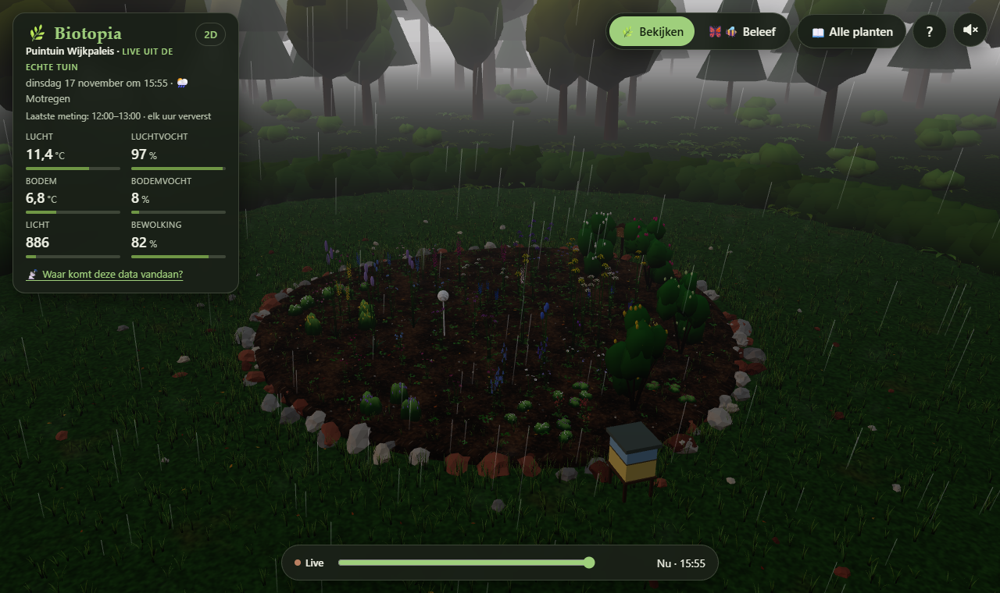
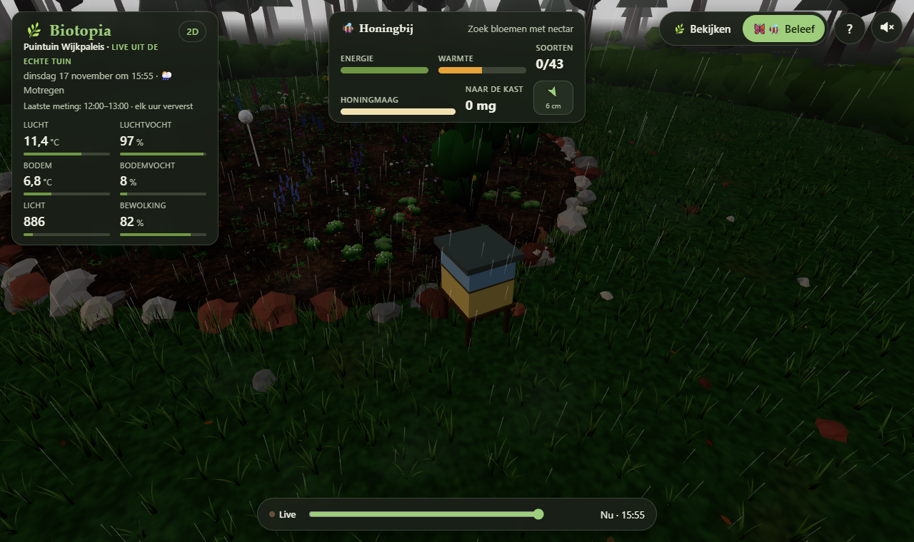

# Biotopia

**A live 3D digital twin of a real wildlife garden.** Biotopia shows the *Puintuin* in Rotterdam as it is right now: the sky, light, mist and rain in the 3D garden come from the hourly measurements of Bioto's **Plantenluisteraar**, a sensor standing in the real garden. You can look around, learn what grows there, and experience the garden as a butterfly or a honeybee.

It started as a Bioto hackathon project (team 14) and aims to teach people about plants, pollinators and nature. The interface is in Dutch.

**Live site: <https://mathijs-04.github.io/Hackaton-Immersive-Tech/>**



## What you can do

- **Watch the garden live.** The weather, sunlight, fog, soil and time of day follow the real sensor data of the current hour. A slider lets you look back through the last days.
- **Learn about the plants.** Click any plant (or the sensor) for a photo, a description, and what the plant means for butterflies and bees.
- **Be a butterfly or a bee.** The world becomes giant. As a *Boomblauwtje* (holly blue butterfly) you explore and discover plants. As a *honingbij* (honeybee) you have a job: collect nectar and bring it to the hive. Real weather decides how easily you fly.
- **Meet the garden's life.** Butterflies, bumblebees, honeybees, dragonflies, ladybirds, snails, mice, bats and birds live in the scene, and a forest surrounds it. They behave according to the weather and time of day.
- **Switch on the music** with the speaker button in the top right corner.
- **Open the 2D dashboard** (`/`) for charts, a map and the planting list.



## Quick start

You need [Node.js](https://nodejs.org/) 20.12 or newer.

```bash
git clone https://github.com/Mathijs-04/Hackaton-Immersive-Tech.git
cd Hackaton-Immersive-Tech
npm install
npm start
```

Open <http://localhost:3000/garden/> (3D) or <http://localhost:3000/> (2D dashboard).

Without any setup this runs in **demo mode** on the data snapshot included in the repository (`static-data/`). The garden then shows the last recorded moment instead of "now" once the snapshot is more than six hours old.

### Live data

To use live data from the Plantenluisteraar you need a Bioto partner **API token** and the **garden id**:

```bash
cp .env.example .env     # then fill in BIOTO_TOKEN and GARDEN_UUID
npm start
```

| Setting | Required | Meaning |
|---|---|---|
| `BIOTO_TOKEN` | for live data | Bioto partner API access token |
| `GARDEN_UUID` | for live data | Id of the garden |
| `API_BASE` | no | API address (default `https://api.bioto.co`) |
| `PORT` | no | Local port (default `3000`) |

The token stays on the server (`.env` is git-ignored) and the browser never talks to Bioto. The server asks Bioto for new data at most **once per hour** and caches it in `data/`.

## Controls

| | Desktop | Phone / tablet |
|---|---|---|
| Look around, zoom | drag, scroll | drag, pinch |
| Open plant info | click a plant | tap a plant |
| Go back in time | time slider, `←` `→` (`Shift` = a day) | time slider |
| Back to now | **Live** button or `L` | **Live** button |
| Choose butterfly or bee | **Beleef** button or `V` | **Beleef** button |
| Fly | `W` `A` `S` `D` or arrows, `Space` up, `Q` down, `Shift` faster | on-screen joystick and ▲ ▼ |
| Land | let go above a flower | let go above a flower |
| Stop flying | `Esc` | **Bekijken** button |
| Music on/off | speaker button or `M` | speaker button |

## How it works

```
Bioto API ──(hourly, token on the server)──► server / GitHub Action ──► static JSON ──► browser
  sensor readings, layout, planting plan        caches, merges history        api/*.json     3D scene (Three.js)
```

- **No build step.** Plain JavaScript modules and [Three.js](https://threejs.org/) in the browser. The only server code is a tiny Node server (`server.js`) with one dependency, `three`.
- **No downloaded models or textures.** Every plant, animal and texture is generated in code, so the site is light and runs on ordinary laptops and phones.
- **Real versus illustrative.** Real: weather and light (from the sensor), sun and moon position (from time and GPS), which species grow in the garden, how many, and their planting dates. Illustrative: the exact position of each plant, plant shapes, the surrounding forest and the animals.

```
server.js            local server (live or demo mode)
lib/bioto.js         the only code that talks to the Bioto API (cache, rate limit)
public/index.html    2D dashboard
public/garden/       the 3D app: world/, plants/, life/, butterfly/, bee/, ui/, data/, core/
public/data/         plant information (photos, texts, pollinator value)
static-data/         bundled snapshot used for demo mode and the website
scripts/             build and check scripts for the website
docs/                detailed documentation
```

## Documentation

| | |
|---|---|
| [How it works](docs/how-it-works.md) | Technical guide: data → visuals, characters, wildlife, code map, adding plants |
| [Data and API](docs/data-and-api.md) | The Bioto API, the data files and what every field means |
| [Deployment](docs/deployment.md) | Publishing on GitHub Pages with an hourly data refresh, and the API request budget |

## Scripts

| Command | What it does |
|---|---|
| `npm start` | Run the local server |
| `npm run fetch` | Download the garden data in advance (needs the token) |
| `npm run build:site` | Build the static website into `dist/` |
| `npm run verify:site` | Check `dist/` for broken links and leaked secrets |

Handy URL options for developers: `?intro=0` skips the welcome dialog, `?stats=1` shows frame rate and draw calls, `?vlinder=1` / `?bij=1` start flying straight away. In the browser console, the object `garden` gives access to the running scene.

## Credits

- Sensor data and the Plantenluisteraar: [Bioto](https://bioto.co/).
- 3D engine: [Three.js](https://threejs.org/) (MIT). The 2D dashboard uses [Chart.js](https://www.chartjs.org/) and [Leaflet](https://leafletjs.com/), loaded from a CDN.
- Plant photos: [Wikimedia Commons](https://commons.wikimedia.org/). Each photo's author and licence are in `public/data/plants.json` and shown under the photo in the app.
- Background music: supplied by the project team (`public/audio/music.mp3`).
